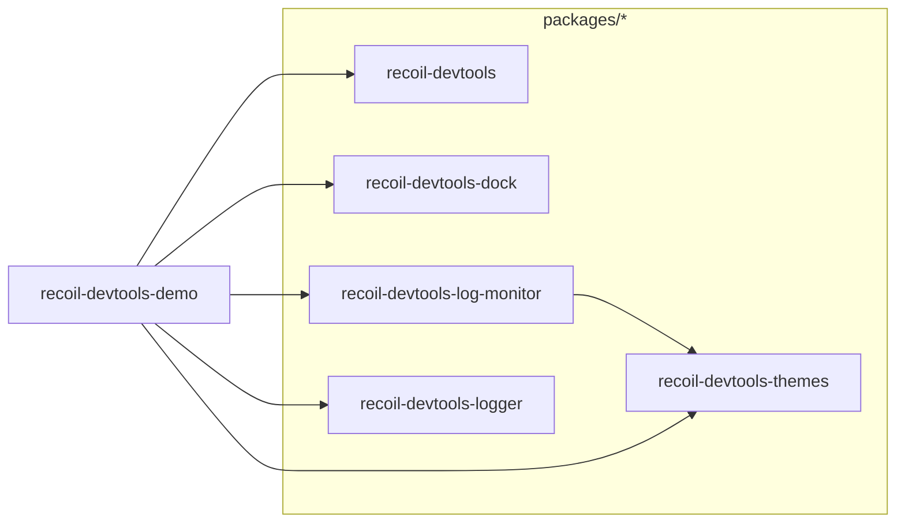
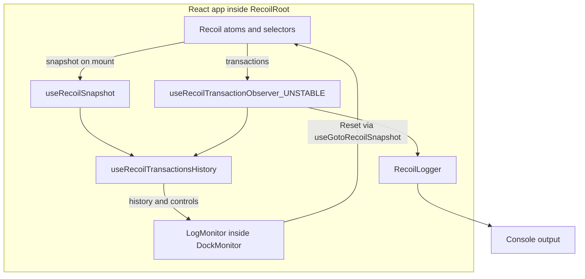

# Recoil DevTools

[](https://github.com/ulises-jeremias/recoil-devtools/actions)
[](LICENSE)
[](https://discord.gg/bR5VyATgka)

> Developer Tools to power-up [Recoil](https://recoiljs.org/) development workflow.

Recoil DevTools provides a complete set of debugging tools for Recoil-based applications, including:

- **Logger**, to log state changes to console
- **Log Monitor**, to visualize state history with time-travel
- **Dock Monitor**, to display devtools in a resizable panel

## Features

- **Time-travel debugging** - Navigate through state history
- **State diffing** - Visualize what changed between states
- **Action toggle** - Enable/disable actions to test scenarios
- **Keyboard shortcuts** - Quick access to toggle visibility and more
- **Persistent state** - Remember dock position between sessions
- **Modern stack** - Built with React 18, TypeScript 5, and Vite

## Packages

This is a monorepo containing the following packages:

### Core Packages

| Package                                                               | npm                                                                                                                            | Version                                                                                                                         | Downloads                             | Description |
| --------------------------------------------------------------------- | ------------------------------------------------------------------------------------------------------------------------------ | ------------------------------------------------------------------------------------------------------------------------------- | ------------------------------------- | ----------- |
| [`recoil-devtools`](packages/recoil-devtools)                         | [](https://www.npmjs.com/package/recoil-devtools)                         | [](https://www.npmjs.com/package/recoil-devtools)                         | Main package with composited DevTools |
| [`recoil-devtools-dock`](packages/recoil-devtools-dock)               | [](https://www.npmjs.com/package/recoil-devtools-dock)               | [](https://www.npmjs.com/package/recoil-devtools-dock)               | Dock container                        |
| [`recoil-devtools-log-monitor`](packages/recoil-devtools-log-monitor) | [](https://www.npmjs.com/package/recoil-devtools-log-monitor) | [](https://www.npmjs.com/package/recoil-devtools-log-monitor) | State history UI                      |

### Utilities

| Package                                                     | npm                                                                                                                  | Version                                                                                                               | Downloads       | Description |
| ----------------------------------------------------------- | -------------------------------------------------------------------------------------------------------------------- | --------------------------------------------------------------------------------------------------------------------- | --------------- | ----------- |
| [`recoil-devtools-logger`](packages/recoil-devtools-logger) | [](https://www.npmjs.com/package/recoil-devtools-logger) | [](https://www.npmjs.com/package/recoil-devtools-logger) | Console logging |
| [`recoil-devtools-themes`](packages/recoil-devtools-themes) | [](https://www.npmjs.com/package/recoil-devtools-themes) | [](https://www.npmjs.com/package/recoil-devtools-themes) | Color themes    |

## Architecture

The workspace in [`pnpm-workspace.yaml`](pnpm-workspace.yaml) contains five
published packages under `packages/*` and the private demo app.

### Package dependencies

Arrows point from a workspace package to a dependency declared in its
`package.json`. Third-party and peer dependencies are omitted.



### React integration and subscriptions

The demo composes `RecoilLogger`, `DockMonitor`, and `LogMonitor` inside
`RecoilRoot`. The history hook captures an initial snapshot and observes
transactions; `RecoilLogger` registers its own transaction observer for console
logging. `DockMonitor` provides the panel that contains the log monitor.



`RecoilDevtools` currently passes its children through unchanged; it does not
forward `values` to them. Set `values` on `LogMonitor` or `RecoilLogger` itself to
observe selected atoms.

## Quick Start

🌐 **Live demo:** <https://ulises-jeremias.github.io/recoil-devtools/>

```bash
# Install all packages
pnpm install

# Run the demo locally
pnpm --filter recoil-devtools-demo dev
```

### Basic Usage

```tsx
import { RecoilRoot } from 'recoil';
import { DockMonitor } from 'recoil-devtools-dock';
import { LogMonitor } from 'recoil-devtools-log-monitor';

function App() {
  return (
    <RecoilRoot>
      <DockMonitor>
        <LogMonitor />
      </DockMonitor>
      {/* Your app */}
    </RecoilRoot>
  );
}
```

### Keyboard Shortcuts

| Shortcut | Action                         |
| -------- | ------------------------------ |
| `Ctrl+H` | Toggle visibility              |
| `Ctrl+Q` | Change dock position           |
| `Ctrl+M` | Change monitor (when multiple) |

## Requirements

- Node.js 18+
- React 17 or 18 (**not React 19** — Recoil still depends on React internals removed in 19)
- Recoil 0.7+

## Project status

> **Heads-up about Recoil**
>
> Meta archived the upstream [Recoil](https://github.com/facebookexperimental/Recoil) repository in early 2025. Recoil itself still works on React 18, but it no longer receives upstream updates.
>
> This monorepo continues as an independent, community-maintained set of devtools for projects that are still on Recoil. There is no ongoing dependency on upstream Recoil development.
>
> If you are starting a new project, consider modern alternatives such as [Jotai](https://jotai.org/), [Zustand](https://zustand.docs.pmnd.rs/), or React's built-in primitives. If you already use Recoil, these devtools are designed to keep your debugging story productive.

## Contributing

Pull requests, bug reports, and feedback are welcome. See [CONTRIBUTING.md](CONTRIBUTING.md) and the [Code of Conduct](CODE_OF_CONDUCT.md).

## License

[MIT](LICENSE)

## 👥 Contributors

<a href="https://github.com/ulises-jeremias/recoil-devtools/contributors">
  
</a>

Made with [contributors-img](https://contrib.rocks).
